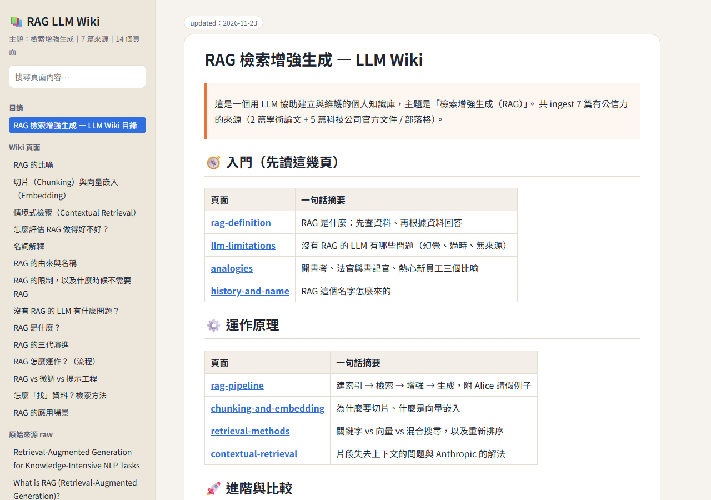
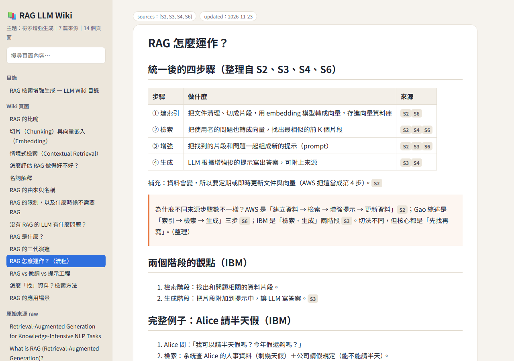
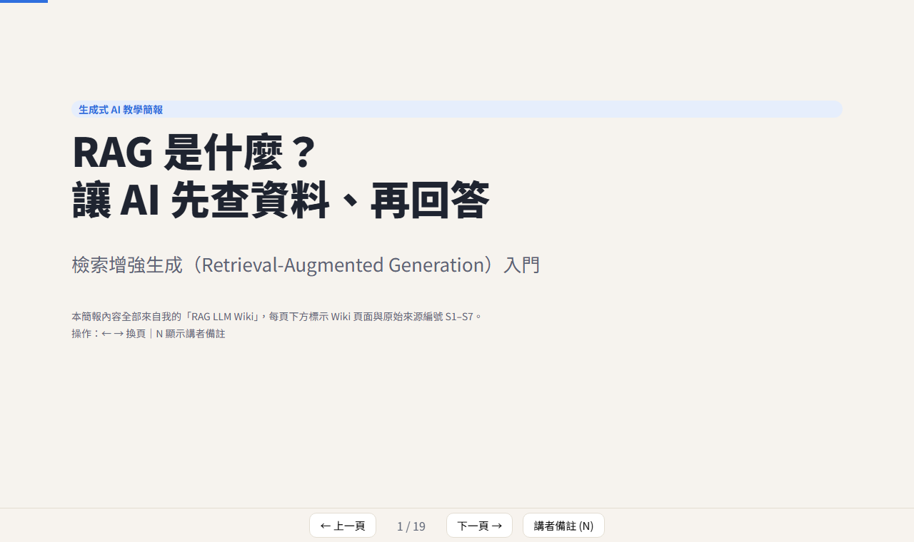
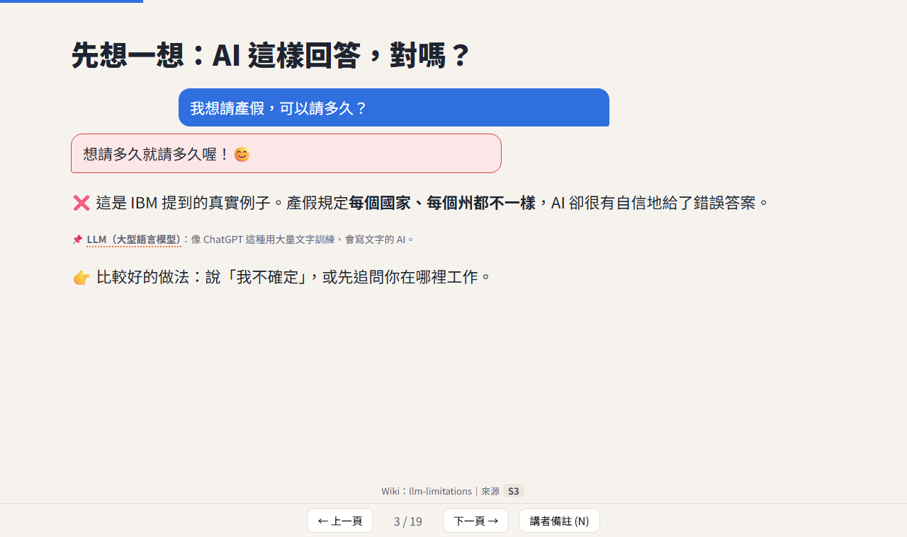
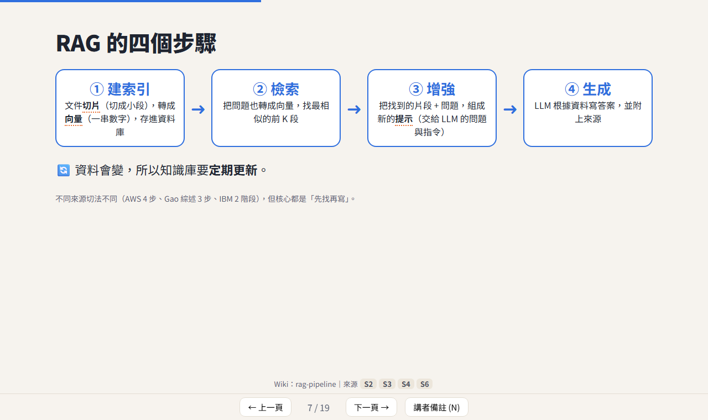
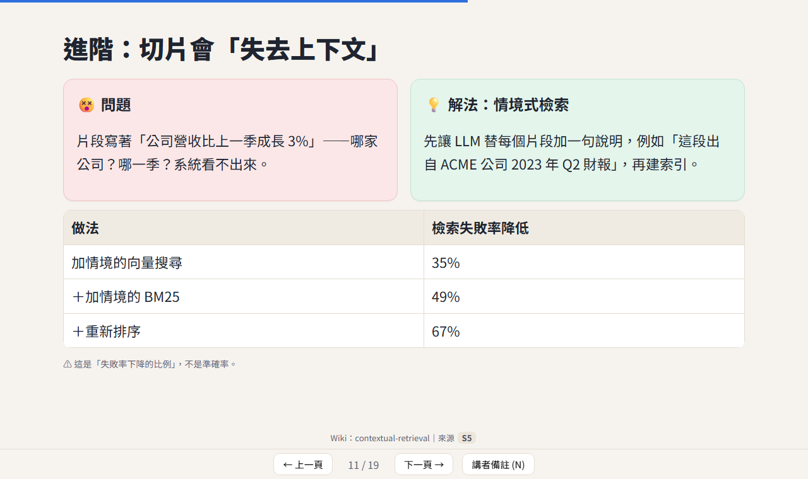
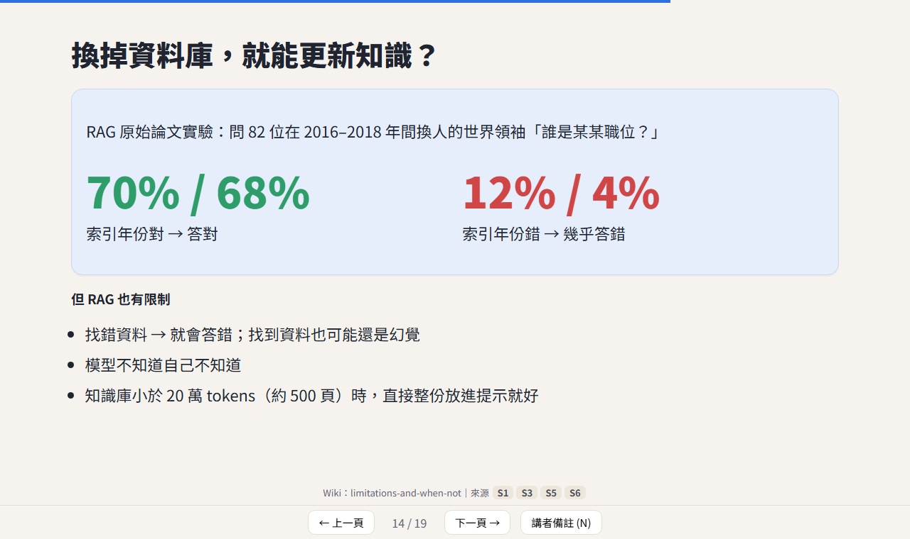
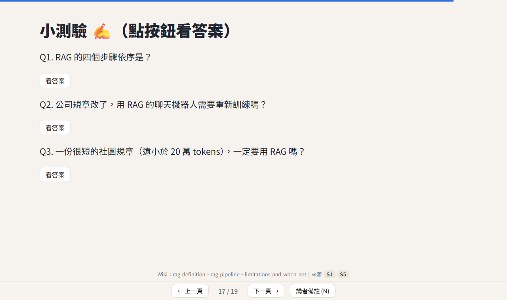
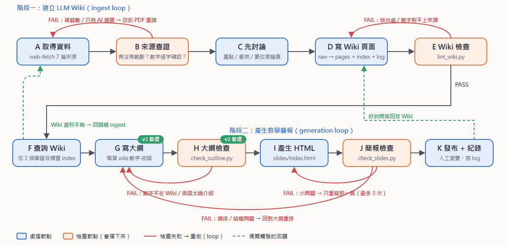
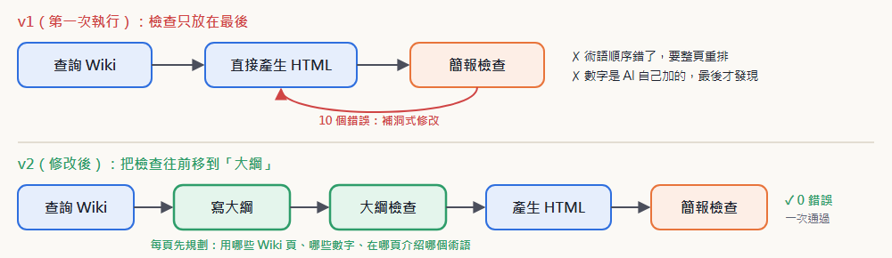

# 用 LLM Wiki 做一份教學 HTML 簡報 —— 主題：RAG 檢索增強生成

> 🔗 作業首頁：`https://<你的GitHub帳號>.github.io/RAG-LLM-Wiki/`
> （上傳 GitHub Pages 後，把 `<你的GitHub帳號>` 換成自己的帳號）

---

## 1. LLM Wiki 主題與簡短介紹

**主題：RAG（Retrieval-Augmented Generation，檢索增強生成）**

上課時學到 LLM 本質上是在「猜下一個字」，所以會有幻覺（hallucination），而且只知道訓練當時的資料。RAG 是業界最常用來改善這兩個問題的方法：**讓 AI 回答之前，先去外部資料庫查相關內容，再根據查到的內容回答。**

選這個主題有三個原因：
1. 跟課程內容（LLM 的限制）直接相關，是很自然的延伸。
2. 找得到有公信力的來源：有原始論文、綜述論文，也有 AWS、IBM、NVIDIA、Microsoft、Anthropic 的官方文件。
3. 很巧的是，「LLM Wiki」本身也是一種「讓 AI 先讀資料再回答」的方法，做完這份作業等於親身體驗了一次 RAG 想解決的問題。

**目標聽眾**：沒有 AI 技術背景的大學生（例如其他科系的同學）。

---

## 2. LLM Wiki 連結與成果

🔗 **Wiki 網頁版**：`https://<你的GitHub帳號>.github.io/RAG-LLM-Wiki/wiki.html`

📁 **原始檔**：`wiki/` 資料夾（Markdown）

### 規模
| 項目 | 數量 |
|---|---|
| Ingest 的來源 | **7 篇**（2 篇學術論文 + 5 篇科技公司官方文件 / 部落格） |
| Wiki 概念頁 | **14 頁** |
| 討論紀錄 | 2 份（主題範圍討論、逐篇 ingest 討論） |
| 操作紀錄 log | 8 筆 |

### 7 篇來源（全部自己上網找，沒有用課堂簡報）
| ID | 來源 | 類型 |
|---|---|---|
| S1 | Lewis et al. (2020). *Retrieval-Augmented Generation for Knowledge-Intensive NLP Tasks*. NeurIPS 2020 | RAG 原始論文 |
| S2 | AWS — *What is RAG?* | 雲端廠商官方說明 |
| S3 | IBM Research Blog — *What is retrieval-augmented generation?* (2023) | 研究機構部落格 |
| S4 | NVIDIA Blog — *What Is Retrieval-Augmented Generation, aka RAG?* (2023, 2025 更新) | 業界官方部落格 |
| S5 | Anthropic — *Introducing Contextual Retrieval* (2024) | AI 公司技術文章 |
| S6 | Gao et al. (2023/2024). *Retrieval-Augmented Generation for LLMs: A Survey* | 學術綜述論文 |
| S7 | Microsoft Learn — *RAG in Azure AI Search*（2026-11 更新） | 官方技術文件 |

### Wiki 結構（參考 LLM Wiki 的 raw / wiki / schema 三層）
```
wiki/
├── CLAUDE.md          ← 規則書：寫作規則、來源編號、三種操作（ingest / query / lint）
├── raw/               ← 7 篇來源的擷取筆記（含讀取紀錄、查證狀態 ✅）
├── discussions/       ← 先討論、後生成的討論紀錄
├── pages/             ← 14 個概念頁（每句有數字的話都標 [S#] 出處）
├── index.md           ← 目錄 + 每頁一句話摘要
└── log.md             ← 每次操作的時間軸紀錄
```

### 「先討論、後生成」怎麼做
1. **討論 00（還沒生成任何頁面前）**：決定主題、聽眾、要回答哪些問題、對應哪些頁面、來源篩選標準。
2. **討論 01（每篇來源 ingest 前）**：重點是什麼、跟其他來源有沒有衝突、要更新哪幾頁，確認後才生成。
   - 例：AWS 說 RAG 有 4 步、Gao 綜述說 3 步、IBM 說 2 階段 → 討論後決定統一成「建索引 → 檢索 → 增強 → 生成」，並在 Wiki 註明各來源的切法不同。
   - 例：Anthropic 的 35% / 49% / 67% 是「檢索失敗率的降幅」不是準確率 → 先在討論中寫清楚，避免簡報寫錯。

### 截圖



---

## 3. 教學 HTML 簡報連結

🔗 **簡報**：`https://<你的GitHub帳號>.github.io/RAG-LLM-Wiki/slides/`

（← → 鍵換頁、手機可左右滑、按 N 顯示講者備註）

### 教學結構（19 頁）
| 段落 | 頁 | 內容 | 對應 Wiki 頁面 |
|---|---|---|---|
| 開場 | 1–2 | 封面、3 個學習目標 | index |
| 引起動機 | 3–4 | AI 答錯產假問題的真實例子 → LLM 的三個問題 | llm-limitations |
| 建立概念 | 5–6 | 開書考、法官與書記官比喻 → RAG 定義 | analogies、rag-definition、history-and-name |
| 運作原理 | 7–10 | 四步驟 → 切片與向量 → 檢索方法 → Alice 請假走一遍 | rag-pipeline、chunking-and-embedding、retrieval-methods、use-cases |
| 進階與比較 | 11–13 | Contextual Retrieval、三代 RAG、RAG vs 微調 | contextual-retrieval、rag-paradigms、rag-vs-finetuning |
| 限制與評估 | 14–16 | 換資料庫實驗、限制、何時不用、評估、應用 | limitations-and-when-not、evaluation、use-cases |
| 收尾 | 17–19 | 小測驗（對應 3 個學習目標）、三句話總結、參考資料 | — |

**Wiki ↔ 簡報的對應方式**：每一頁簡報的 HTML 都有 `data-wiki="頁面名稱"`，畫面下方也會顯示「Wiki：頁面名稱｜來源 S#」，所以每一頁內容都能追溯回 Wiki 和原始來源。

### 截圖
| | |
|---|---|
|  |  |
|  |  |
|  |  |

---

## 4. Loop / Graph 設計



### 節點說明
| 節點 | 做什麼 | 類型 | 失敗時回到哪 |
|---|---|---|---|
| A 取得資料 | 上網抓來源 | 處理 | — |
| B 來源查證 | 檢查有沒有被截斷？數字是不是原文逐字讀到的？ | **檢查** | 回 A：改抓 PDF 重讀 |
| C 先討論 | 重點、衝突、要更新哪幾頁 | 處理 | — |
| D 寫 Wiki 頁面 | raw → pages，更新 index 和 log | 處理 | — |
| E Wiki 檢查 | `lint_wiki.py`：有數字就要有 [S#]、數字要在來源筆記找得到、連結不能壞、不能有孤兒頁 | **檢查** | 回 D |
| F 查詢 Wiki | 依 3 個學習目標查 index，挑出要用的頁面 | 處理 | Wiki 不夠 → 回 A 補資料 |
| G 寫大綱（v2 新增） | 每頁先規劃：用哪些 Wiki 頁、會出現哪些數字、在哪頁介紹哪個術語 | 處理 | — |
| H 大綱檢查（v2 新增） | `check_outline.py`：數字在 Wiki 裡、術語先介紹再使用、每個學習目標都有內容頁 + 測驗 + 總結 | **檢查** | 回 G |
| I 產生 HTML | 依大綱產生 `slides/index.html` | 處理 | — |
| J 簡報檢查 | `check_slides.py`：出處、數字回溯、術語有 `<dfn>` 解釋、每頁 ≤ 250 字、教學結構完整 | **檢查** | 小問題回 I；結構問題回 G |
| K 發布 + 紀錄 | 人工瀏覽、截圖、寫 log | 處理 | 好的問答回存 Wiki（回 D） |

### 哪些步驟會重複執行？
1. **A → B → C → D → E（ingest loop）**：每多一篇來源就跑一次，這次跑了 7 次。每 ingest 一篇都要重跑 E，因為新來源可能會改到舊頁面。
2. **D ⇄ E（Wiki 修正 loop）**：Lint 沒過就回去改頁面，直到 PASS。
3. **F 查詢 Wiki**：每個學習目標各查一次（3 次）。
4. **G ⇄ H、I ⇄ J（簡報修正 loop）**：沒過就重做。I ⇄ J 最多 3 次，超過代表問題出在大綱，要回 G。

### 哪些地方需要檢查或重新生成？
- **B 來源查證**：AI 讀網頁時可能被截斷，後半段只剩「AI 自動摘要」。摘要有可能是錯的，所以**有數字的內容一定要逐字確認**，沒確認就不准寫進 Wiki。
- **E Wiki 檢查**：確認 Wiki 的每個數字都能對回原始來源（防止整理時 AI 自己編）。
- **H 大綱檢查**：在花時間產生 HTML 之前，先擋下「Wiki 沒有的數字」和「術語順序錯誤」。
- **J 簡報檢查**：最後一道防線，確認簡報 ↔ Wiki 對得起來、對初學者友善。

### 為什麼這樣設計？
- **把「事實正確」和「教學品質」分開檢查**：E 管「Wiki 對不對得上來源」，J 管「簡報對不對得上 Wiki、初學者看不看得懂」。這樣簡報出錯時，可以很快判斷是 Wiki 的問題還是簡報的問題。
- **每一層只信任上一層**：來源 → Wiki → 大綱 → 簡報，每往下一層都檢查「有沒有多出上一層沒有的東西」。這跟 RAG 評估裡的「答案忠實度（Answer Faithfulness）」是同一個概念。
- **檢查用程式而不是用 AI 自己檢查自己**：用 Python 腳本做規則檢查，結果穩定、可以重跑，也留得下紀錄。
- **越早檢查越便宜**：在大綱階段發現術語順序錯，改一行字就好；到 HTML 才發現，要搬動整頁內容。

---

## 5. 一次實際執行的結果與檢查紀錄

完整原始紀錄在 `runs/` 資料夾（每次檢查的輸出都存成 txt）。

| # | 節點 | 結果 | 發現的問題 → 處理方式 |
|---|---|---|---|
| 0 | B 來源查證 | ⚠ 2 篇有問題 | S1、S6 的 arXiv 網頁只讀到前 30–45%，後半是 AI 摘要；PDF 直接讀是亂碼 → **回到 A**，用 PyMuPDF 從 PDF 抽文字，逐字確認 82 位世界領袖、70%/68%/12%/4%、評估的 3 個分數 + 4 種能力。還發現 **AI 摘要說「論文沒寫領袖人數」，但原文明明寫了 82 位** |
| 1 | E Wiki 檢查 第 1 次 | ❌ 8 個錯誤 | 6 處有數字但沒附 [S#]；2 處內文引用 S4、S7 但 frontmatter 沒列 → 回 D 修正 |
| 2 | E Wiki 檢查 第 2 次 | ✅ PASS | 0 錯誤 |
| 3 | J 簡報檢查（v1）第 1 次 | ❌ 26 個錯誤 | 其中 **16 個是檢查器自己的 bug**（把「Wiki：」的 "iki" 當成頁面名稱）→ 先修檢查器 |
| 4 | J 簡報檢查（v1）第 2 次 | ❌ 10 個錯誤 | 2 個 Wiki 裡沒有的數字（講者備註「15 分鐘」、測驗題「50 頁」）；8 個術語第一次出現沒有解釋（LLM、提示、切片、向量、token、BM25、重新排序、微調）。其中第 7 頁一次冒出 3 個術語，第 8 頁才解釋 |
| 5 | **改 workflow → v2**，H 大綱檢查 | ✅ PASS | 新增 `slides/outline.md` 和 `check_outline.py` |
| 6 | H 大綱檢查「回測」 | ❌ 5 個錯誤（符合預期） | 故意把 v1 的錯誤放回大綱副本 → 成功抓到 50 頁、LLM/提示沒介紹、切片/向量太晚介紹，**證明這個檢查真的有效** |
| 7 | J 簡報檢查（v2，依大綱重新產生） | ✅ PASS | 0 錯誤 |

### 實際錯誤訊息節錄
```
== Slide Check：index.html，共 19 頁 ==
ERROR   [第1頁/cover] 數字「15」在 Wiki 頁面 ['index', 'rag-definition'] 找不到 → 可能是 AI 自己加的
ERROR   [第4頁/content] 術語「LLM」第一次出現，但沒有用 <dfn> 解釋
ERROR   [第7頁/content] 術語「提示」第一次出現，但沒有用 <dfn> 解釋
ERROR   [第7頁/content] 術語「切片」第一次出現，但沒有用 <dfn> 解釋
ERROR   [第7頁/content] 術語「向量」第一次出現，但沒有用 <dfn> 解釋
...
ERROR   [第17頁/quiz] 數字「50」在 Wiki 頁面 [...] 找不到 → 可能是 AI 自己加的
結果：10 個錯誤、0 個警告 → FAIL
```

---

## 6. 反思



### Q1. 哪一個節點最常出錯？
**「I 產生 HTML 簡報」最常出錯**（10 個真正的錯誤，Wiki 撰寫節點是 8 個）。它的錯誤分成兩種：
1. **自己加料**：AI 寫簡報時會「順手」補上 Wiki 裡沒有的數字，例如講者備註寫「今天用 15 分鐘」、測驗題寫「50 頁的社團規章」。看起來無害，但這正是幻覺的起點：如果不檢查，下一次加的可能就是錯的統計數字。
2. **教學順序錯**：AI 會在第 7 頁一次用掉「切片、向量、提示」三個術語，第 8 頁才解釋。對懂的人沒差，但對初學者就是看不懂。

另外，**最危險的是「A 取得資料」**。出錯次數不多（7 篇裡有 2 篇），但錯誤很隱密：網頁被截斷後，AI 會用「摘要」補上後半段，看起來很完整。我還抓到摘要說「論文沒寫領袖人數」，但原文其實寫了 82 位。如果沒有 B 節點，錯誤的內容就會一路流進 Wiki 和簡報。

### Q2. 發現問題後，把檢查往前移到了哪一個步驟？
1. **簡報部分：從「J 簡報檢查（最後）」往前移到「G/H 大綱階段」。** 在產生 HTML 之前，大綱要先寫清楚每一頁「用哪些 Wiki 頁、會出現哪些數字、在哪一頁介紹哪個術語」，然後用 `check_outline.py` 檢查數字和術語順序。
2. **來源部分：數字查證從「E Wiki 檢查」往前移到「B 來源查證」。** 一開始我以為 Lint 就夠了，但 Lint 只能檢查「Wiki 的數字有沒有出現在 raw 筆記裡」。如果 raw 筆記本身就是從錯誤摘要抄來的，Lint 也會通過。所以查證必須在寫 raw 筆記的當下就做，每個數字都要標 ✅ 才能用。

### Q3. 有沒有因此修改 workflow / graph？為什麼？
**有，從 v1 改成 v2，在「查詢 Wiki」和「產生 HTML」之間多了「G 寫大綱」和「H 大綱檢查」兩個節點。**

原因：
- v1 抓到的錯誤，大多是**規劃層級**的問題（術語該在哪頁介紹、哪些數字可以用），不是句子層級的問題。在 HTML 階段修只是補洞，例如硬塞一個括號解釋。在大綱階段修，可以直接調整頁面順序。
- **越早檢查越便宜**：大綱是純文字，改一行就好；HTML 有排版，改起來要動整頁。
- **回測證明有效**：把 v1 的錯誤放回大綱，`check_outline.py` 能抓到 5 個錯誤；照新大綱重新產生的簡報，`check_slides.py` 一次就通過（0 錯誤）。

### 額外學到的一件事：檢查器本身也會錯
第一次跑簡報檢查時有 26 個錯誤，嚇了一跳，結果其中 16 個是我的檢查程式寫錯了（正規表達式把「Wiki」裡的 "iki" 當成頁面名稱）。所以我學到：**檢查節點本身也要被檢查**。這也是我後來做「回測」的原因：故意放錯誤進去，確認檢查器真的抓得到，而不是一直顯示 PASS 卻什麼都沒檢查到。

---

## 附錄：檔案說明
| 檔案 | 用途 |
|---|---|
| `index.html` | 作業首頁（本文件的網頁版） |
| `wiki.html` | Wiki 網頁版（由 `pipeline/build_wiki_html.py` 產生） |
| `slides/index.html` | 教學 HTML 簡報 |
| `slides/outline.md` | 簡報大綱（v2 新增） |
| `pipeline/lint_wiki.py` | 節點 E：Wiki 檢查 |
| `pipeline/check_outline.py` | 節點 H：大綱檢查 |
| `pipeline/check_slides.py` | 節點 J：簡報檢查 |
| `runs/*.txt` | 每次檢查的原始輸出紀錄 |
| `assets/` | 流程圖與截圖 |
